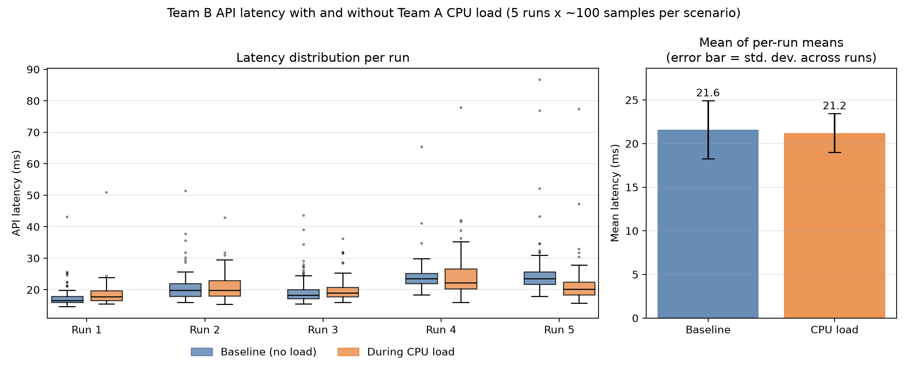

# Báo cáo kỹ thuật - Nền tảng CaaS nhiều nhóm

**Đề tài 10:** Xây dựng nền tảng CaaS nhỏ cho nhiều nhóm phát triển với quota và cô lập tài nguyên  
**Môi trường kiểm thử:** Windows/Docker Desktop, k3d, Kubernetes `v1.35.5+k3s1`, 1 server + 2 agent  
**Ngày ghi nhận kết quả:** 27-10-2026

## 1. Câu hỏi nghiên cứu và kết luận

**Câu hỏi:** Một cụm container dùng chung cần những kiểm soát nào để các nhóm tự triển khai mà không ảnh hưởng tài nguyên và bảo mật của nhau?

Trong phạm vi phòng lab, câu trả lời là kết hợp namespace theo nhóm, ResourceQuota/LimitRange, RBAC tối thiểu, NetworkPolicy mặc định từ chối, kiểm soát Pod Security/admission, quản lý Secret riêng theo namespace và giám sát tập trung. Không một lớp nào tự tạo ranh giới bảo mật cứng: quota không dành riêng CPU vật lý, network policy cần CNI hỗ trợ, và các namespace vẫn dùng chung kernel/node/control plane.

Các kiểm soát trên đã được cài lên cụm và kiểm tra bằng workload mẫu. Thử nghiệm tải nhỏ xác nhận quota có thể chặn mức request vượt ngưỡng, và phép đo độ trễ (5 lượt x 100 mẫu, có thí nghiệm đối chứng) không cho thấy suy giảm vượt mức nhiễu đo. Kết quả phù hợp với mục tiêu minh họa, không phải chứng nhận production hay benchmark thống kê.

## 2. Kiến trúc và workload

```text
Người vận hành / Helm
  ├── kube-prometheus-stack (namespace monitoring)
  │     ├── Prometheus + kube-state-metrics + Node Exporter
  │     └── Grafana: dashboard CaaS theo namespace
  ├── Kyverno (namespace kyverno)
  │     └── policy image, security context, resource requests/limits
  └── Kubernetes control plane + k3d (1 server, 2 agents)
        ├── team-dev-a: Team A API + nginx
        ├── team-dev-b: Team B API + HTTPBin
        ├── team-dev-c: nginx mẫu
        └── team-shared: PostgreSQL + Redis
```

Ba namespace `team-dev-a`, `team-dev-b`, `team-dev-c` đại diện ba nhóm; `team-shared` là dịch vụ dùng chung. `monitoring` và `kyverno` được tách riêng để công cụ nền tảng không tiêu quota của các nhóm. PostgreSQL dùng PVC `local-path`; Grafana, Prometheus và Alertmanager cũng có PVC riêng.

API A/B dùng image build cục bộ rồi import vào k3d với `imagePullPolicy: Never`. Tag `ghcr.io/team10/...` hiện là tên image cục bộ để khớp allowlist policy, **không đồng nghĩa image đã được push hoặc xác nhận bởi GitHub Container Registry**.

## 3. Nền tảng lý thuyết

### CaaS, runtime và control plane

Container-as-a-Service (CaaS) cung cấp giao diện/API để nhóm ứng dụng yêu cầu triển khai container trên hạ tầng được nền tảng quản lý. Kubernetes API server tiếp nhận và xác thực yêu cầu; scheduler chọn node; controllers đối chiếu trạng thái mong muốn với trạng thái thực; kubelet làm việc với container runtime (containerd trong cụm k3d) để chạy Pod. Namespace, RBAC, quota, network policy và admission controller là các cơ chế tổ chức/kiểm soát ở lớp Kubernetes, không phải máy ảo riêng cho từng tenant.

### Request, limit, quota, scheduling, eviction và noisy neighbor

- **Request** là lượng tài nguyên được scheduler dùng để quyết định Pod có thể đặt lên node hay không; tổng request lớn có thể làm Pod `Pending`.
- **Limit CPU** giới hạn thời gian CPU và có thể gây throttling khi workload bận. **Limit memory** là ngưỡng cứng; container có thể bị OOM-kill nếu vượt giới hạn.
- **ResourceQuota** đặt tổng mức dùng/request/limit và số đối tượng trong namespace. Quota được admission controller thực thi khi tạo/cập nhật tài nguyên, nhưng không biến CPU/RAM vật lý thành phần cứng riêng.
- **LimitRange** đặt min/max và mặc định trên từng container; giúp Pod thiếu thông số không tạo cấu hình không kiểm soát.
- **Eviction** là quyết định của kubelet khi node chịu áp lực tài nguyên; đây không phải cơ chế công bằng theo tenant. Request, QoS class, mức vượt request và mức độ ưu tiên ảnh hưởng thứ tự xử lý.
- **Noisy neighbor** là workload của một nhóm làm suy giảm latency/throughput nhóm khác khi cùng cạnh tranh CPU, memory, I/O hoặc mạng. CPU limit giảm khả năng chiếm CPU liên tục, nhưng không loại bỏ hoàn toàn cạnh tranh node.

Trong cấu hình lab, mỗi team có requests CPU/RAM tối đa `1 core/1Gi`, limits tối đa `2 cores/2Gi`, tối đa 6 Pod; mỗi container có CPU `50m–500m`, RAM `64Mi–512Mi`. Default mỗi container là request `100m/128Mi`, limit `250m/256Mi`. Quota còn chặn số Deployment, Service, ConfigMap và PVC. Namespace `team-shared` có quota riêng.

### RBAC, ServiceAccount, NetworkPolicy và admission

- RBAC quyết định danh tính được thực hiện verb nào trên tài nguyên nào. Role/RoleBinding giới hạn quyền trong namespace; ServiceAccount đại diện danh tính workload/nhóm trong cụm.
- NetworkPolicy lọc luồng L3/L4 vào/ra Pod. Chính sách mặc định từ chối được kết hợp các ngoại lệ cần thiết: DNS, lưu lượng cùng nhóm, truy cập PostgreSQL/Redis dùng chung, và Prometheus scrape API. NetworkPolicy chỉ có hiệu lực nếu CNI thực thi chính sách; kiểm thử kết nối thực tế là cần thiết.
- Pod Security Admission `restricted` và Kyverno kiểm tra thuộc tính Pod trước khi chấp nhận: nguồn image, tag, non-root, capabilities, privilege escalation và tài nguyên khai báo.
- Namespace là **multi-tenancy mềm**: workload vẫn chia sẻ kernel, kubelet và control plane; quản trị viên cụm vẫn có quyền cao. Cần cụm/node pool riêng cho tenant không tin cậy hoặc yêu cầu cách ly mạnh.

### Registry, provenance, Secret và trách nhiệm

Kyverno chỉ cho phép các repository `docker.io/library`, `docker.io/nginxinc`, `docker.io/mccutchen`, `ghcr.io/team10`, `registry.k8s.io`, yêu cầu tag phiên bản hoặc digest, đồng thời từ chối tag `latest`. Đây là allowlist nguồn/repository, **chưa xác minh người build, chữ ký Cosign, SBOM, lỗ hổng hay provenance**; tag phiên bản vẫn có thể bị registry thay đổi. Hệ thống production nên dùng registry riêng (ví dụ Harbor), image bất biến theo digest, xác minh chữ ký/provenance trong admission, quét lỗ hổng và có quy trình cập nhật bản vá.

Secret Kubernetes được tạo riêng trong từng namespace; team không được RBAC đọc Secret của team khác và Pod không tự mount ServiceAccount token. Team A và B dùng role/database PostgreSQL riêng (`team_a`/`caas_team_a`, `team_b`/`caas_team_b`) cùng Redis ACL user riêng, chỉ truy cập key có prefix của team. Secret quản trị được giữ trong `team-shared`; API chỉ nhận credential tương ứng trong namespace của mình. Script init chỉ tạo role/database khi PVC PostgreSQL được khởi tạo lần đầu. Secret API không phải hệ thống vault; dữ liệu base64 không phải mã hóa. Production cần mã hóa etcd, RBAC vận hành chặt, xoay vòng secret và cân nhắc external secret manager.

Nền tảng chịu trách nhiệm cấp namespace, quota, admission, network, registry policy, monitoring và quy trình ứng cứu. Nhóm ứng dụng chịu trách nhiệm image/code an toàn, requests/limits hợp lý, cập nhật dependency, Secret cần thiết và health/metrics của dịch vụ.

## 4. Cấu hình kiểm soát trong repo

| Kiểm soát | Vị trí chính | Tác dụng |
|---|---|---|
| Ba tenant namespace + Pod Security `restricted` | `namespaces/tenants.yaml` | Phân vùng nhóm, baseline bảo mật Pod |
| Quota / LimitRange | `resourcequota-team-*.yaml`, `limitrange-team-*.yaml` | Chặn mức tài nguyên/đối tượng; đặt min/max/default |
| Dịch vụ dùng chung | `shared-resourcequota.yaml`, `manifests/apps/team-shared.yaml` | PostgreSQL/Redis có quota và storage riêng |
| ServiceAccount/RBAC | `rbac-team-a.yaml`, `rbac-team-b.yaml`, `rbac-team-c.yaml`, `security/default-serviceaccounts.yaml` | Quyền khác nhau theo nhóm, tắt auto-mount token |
| Default deny và luồng cho phép | `network-policy-deny-all.yaml`, `networkpolicy-team-*.yaml`, `network-policy-allow-shared.yaml` | DNS, trong nhóm, shared services, Prometheus scrape |
| Admission/image policy | `kyverno/policies.yaml` | Allowlist repository, cấm `latest`, non-root, drop capabilities, limits/requests |
| Dashboard/metrics | `monitoring/tenant-dashboard.yaml`, `manifests/apps/team-api-servicemonitors.yaml` | CPU/RAM, Pod/quota và request rate theo team |
| Kiểm thử lặp lại | `scripts/validate-platform.ps1`, `examples/` | Kiểm tra cho phép/bị từ chối và tải cạnh tranh có giới hạn |

### Khác biệt RBAC theo nhóm

| Nhóm | Deployments | Pods | Services/ConfigMaps |
|---|---|---|---|
| A | CRUD | get/list/watch; không tạo Pod trực tiếp | CRUD |
| B | CRUD | get/list/watch | get/list/watch/create/update/patch; không xóa |
| C | get/list/watch/create/update/patch; không xóa | Không được cấp quyền | get/list/watch |

Không Role nào cấp quyền đọc Secret, sửa Role/RoleBinding hay truy cập namespace khác. Đây là ServiceAccount mẫu để minh họa; đăng nhập thật của người dùng cần tích hợp OIDC/IdP và ánh xạ user/group vào RoleBinding phù hợp.

## 5. Ma trận kiểm thử và kết quả

Kiểm thử trên cụm `caas-phat-lab`, ngày 27-10-2026. `PASS` nghĩa là cơ chế cho kết quả mong đợi, kể cả khi yêu cầu bị từ chối.

| Thử nghiệm | Kết quả thực tế | Kỳ vọng | Đánh giá |
|---|---|---|---|
| Ba namespace tenant, 3 node Ready | Đủ `team-dev-a/b/c`; server + 2 agent Ready | Tách ba nhóm | PASS |
| Workload A/B/C và shared DB/Redis | API A/B, nginx A/C, HTTPBin B, PostgreSQL, Redis đều Ready | Mỗi nhóm có workload; dịch vụ shared hoạt động | PASS |
| API A/B truy vấn PostgreSQL/Redis | API trả `postgres: 1`, bộ đếm Redis tăng | Shared egress được phép đúng cổng | PASS |
| Cùng namespace A tới nginx A; B tới HTTPBin B | HTTP 200 | Lưu lượng cần thiết trong nhóm được phép | PASS |
| A tới API B và B tới API A | TCP connection bị từ chối (`ConnectionRefusedError`) | Chặn truy cập chéo | PASS |
| A tới PostgreSQL 5432 và Redis 6379 dùng chung (TC-29, TC-30) | Kết nối được (`connect_ex = 0`) | Luồng được phép hoạt động | PASS |
| A tới nginx Team C cổng 8080, Pod đang lắng nghe (TC-31) | Kết nối bị từ chối (`111`) | Chặn truy cập chéo sang Team C | PASS |
| Role A tạo Deployment / tạo Pod trực tiếp | Quyền Deployment được cấp; quyền tạo Pod bị từ chối sau áp dụng RBAC tối thiểu | Ít quyền nhất, buộc triển khai qua controller | PASS |
| Role B xóa Service; Role C xóa Deployment | Cả hai quyền đều bị từ chối; C được tạo/cập nhật Deployment | Quyền khác nhau | PASS |
| Role A đọc Secret ở namespace B | `kubectl auth can-i` trả `no` | Không đọc Secret chéo namespace | PASS |
| Team A/B truy cập database chéo | Kết nối role tenant đến database của nhóm còn lại bị từ chối (`permission denied for database`) | Database/role phân tách theo team | PASS |
| Team A/B đọc key prefix chéo trong Redis | `GET` key của nhóm khác bị từ chối (`NOPERM`) | ACL giới hạn key theo tenant | PASS |
| Image `:latest` và image từ `quay.io` | Kyverno webhook từ chối | Chỉ nhận repo/tag được duyệt | PASS |
| Pod root | Pod Security Admission `restricted` từ chối | Không chạy root | PASS |
| CPU requests 1.2 cores trong quota 1 core | API từ chối; quota đang dùng 150m, giới hạn 1 CPU | Chặn vượt quota | PASS |
| Container limit CPU 600m trong max 500m | LimitRange từ chối | Chặn container quá giới hạn | PASS |
| Pod không khai báo resource trong ví dụ mặc định | Admission thêm request 100m/128Mi, limit 250m/256Mi | Áp dụng default LimitRange | PASS |
| Prometheus scrape API A/B | 2 target tenant, cả hai `up=1`; query metrics ứng dụng có series | API metrics được thu thập | PASS |
| Grafana dashboard tenant | Sidecar nạp ConfigMap dashboard thành công (`200 OK`) | Dashboard theo namespace | PASS |
| CPU neighbor load trong Team A | 4 Pod cùng agent-0, mỗi request 200m/limit 250m; quota hiển thị tổng request 950m/1 core, Pod 6/6 | Giới hạn được áp dụng, có thể quan sát cạnh tranh | PASS |

Lần chạy lại `scripts/validate-platform.ps1` sau khi bật credential riêng đạt **27 kiểm tra thành công, 0 lỗi**; chạy thêm tùy chọn tải CPU đạt **28/28**. Bộ này xác minh API A/B thực sự đọc PostgreSQL và Redis, quyền truy cập chéo database/key Redis bị từ chối ở cả hai chiều, ngoài kiểm tra quota, RBAC, network, admission và LimitRange.

### Đo latency trong bài thử tải

**Phương pháp.** Latency của Team B API được đo ngay bên trong pod `team-b-api` (gọi `127.0.0.1:8080`), nên không tính overhead của `kubectl`/port-forward. Bốn pod `cpu-pressure` của Team A (request 200m, limit 250m mỗi pod) được ghim cùng node với `team-b-api` bằng `nodeSelector`, vì nếu khác node thì không có cạnh tranh CPU để quan sát. Thí nghiệm gồm 5 lượt; mỗi lượt đo 100 mẫu cho mỗi kịch bản (sau 5 request khởi động bị loại), nghỉ 20 giây sau khi gỡ tải, và thứ tự baseline/có tải đan xen giữa các lượt để giảm sai lệch do thứ tự. Latency là end-to-end của API (bao gồm PostgreSQL/Redis). Dữ liệu thô nằm ở `evidence/latency-samples.csv`, điều kiện chạy ở `evidence/latency-run-info.txt`, script ở `scripts/measure-latency.ps1` và `scripts/plot-latency.py`.

**Thí nghiệm đối chứng.** Để biết mức nhiễu đo tự nhiên, nhóm chạy thêm một thí nghiệm A/A với cùng quy trình nhưng không bật tải (`evidence/latency-samples-control.csv`). Mọi chênh lệch giữa hai kịch bản chỉ có ý nghĩa nếu vượt được mức dao động này.

| Lượt | TB không tải | TB có tải | Tỉ lệ có tải/không tải | Tỉ lệ ở đối chứng (không tải) |
|---|---:|---:|---:|---:|
| 1 | 17.56 ms | 18.62 ms | 1.06 | 1.24 |
| 2 | 20.97 ms | 21.18 ms | 1.01 | 1.10 |
| 3 | 19.54 ms | 20.05 ms | 1.03 | 0.94 |
| 4 | 24.30 ms | 24.60 ms | 1.01 | 1.04 |
| 5 | 25.59 ms | 21.64 ms | 0.85 | 0.95 |

Số liệu gộp (500 mẫu mỗi kịch bản, 0 lỗi):

| Thí nghiệm | Kịch bản | Trung bình | Trung vị | P95 | Cao nhất |
|---|---|---:|---:|---:|---:|
| Chính | Không tải | 21.59 ms | 20.69 ms | 29.68 ms | 86.77 ms |
| Chính | Có tải CPU | 21.22 ms | 19.87 ms | 30.54 ms | 77.89 ms |
| Đối chứng | Lượt "không tải" thứ nhất | 18.49 ms | 17.07 ms | 26.38 ms | 55.50 ms |
| Đối chứng | Lượt "không tải" thứ hai | 19.41 ms | 17.77 ms | 27.34 ms | 75.19 ms |



**Diễn giải.** Có tải, trung bình chậm hơn 1–6% ở 4/5 lượt nhưng nhanh hơn khoảng 15% ở lượt 5; trung bình gộp không cao hơn (21.22 so với 21.59 ms) và P95 cao hơn khoảng 3% (30.54 so với 29.68 ms). Thí nghiệm đối chứng, vốn không có tải, cho tỉ lệ giữa hai lượt dao động từ 0.94 đến 1.24, lớn hơn các chênh lệch 1–6% ở trên. Vì vậy, với tải này (4 pod x 250m trên cùng node, trong quota Team A), nhóm không phát hiện suy giảm latency ổn định của Team B vượt mức nhiễu đo. Đây là kết quả phù hợp với thiết kế (CPU limit chặn tải ở mức 1 core tổng), nhưng không chứng minh noisy neighbor không xảy ra.

**Hạn chế.** Cụm k3d chạy trên Docker Desktop, các node cùng chia sẻ một máy chủ nên bản thân nền đo đã nhiễu; chỉ có 5 lượt và chỉ đo trung bình/trung vị/P95 (chưa đủ mẫu cho P99); tải chỉ là CPU, chưa thử memory bandwidth, disk I/O hay network; API nhẹ nên ít nhạy với cạnh tranh CPU. Quota và limit không bảo đảm cô lập hoàn toàn: node, memory bandwidth, disk I/O, network và control plane vẫn dùng chung. Mẫu thử 12 điểm trước đó được giữ lại ở `evidence/latency-benchmark-pilot.csv` như lần thử sơ bộ.

## 6. Giám sát

Helm release `monitoring` dùng `kube-prometheus-stack` chart `92.14.0`. Prometheus scrape kubelet/cAdvisor, kube-state-metrics và ServiceMonitor API A/B. Dashboard Grafana **CaaS - tài nguyên theo nhóm** hiển thị:

- CPU usage và memory working set theo namespace;
- Pod đang chạy và mức used/hard của quota;
- HTTP request rate theo nhãn team của API A/B.

Team C dùng nginx mẫu nên chưa có metric nghiệp vụ. Dashboard dùng resource metrics Kubernetes; muốn đánh giá workload thật nên bổ sung latency histogram/error rate, tải có kịch bản và lưu dữ liệu kiểm thử dài hơn.

## 7. Giới hạn và hướng phát triển

1. Namespace không phải ranh giới bảo mật cứng; production tenant không tin cậy nên dùng cluster/node pool riêng hoặc sandbox runtime (gVisor/Kata) phù hợp.
2. RBAC hiện minh họa quyền bằng ServiceAccount; cần OIDC/IdP, danh tính từng người và quy trình cấp/thu hồi.
3. Allowlist registry/repository và tag phiên bản chưa xác minh provenance/signature; tích hợp Harbor/Cosign, digest pinning, SBOM và scan trước khi admission.
4. Secret hiện ở Kubernetes Secret; cần encryption-at-rest, external secret manager và rotate key/password.
5. Quota namespace không tạo CPU/memory reservation vật lý riêng, không áp dụng fairness cho mọi I/O và không ngăn mọi tác động node-level. Cần theo dõi eviction, OOM, CPU throttling và P95/P99 dưới tải dài.
6. NetworkPolicy phụ thuộc implementation của CNI. Kiểm thử đã xác nhận chặn TCP trên cụm k3d này; khi đổi CNI hoặc nền tảng phải chạy lại test.
7. Danh mục tài liệu [9], [10], [19], [23] và bài giảng Chương 2 cần đối chiếu số thứ tự/tên tài liệu trong đề cương gốc của lớp; không tự gán số thứ tự khi chưa có thư mục tham khảo.

## 8. Tài liệu tham khảo kỹ thuật

- Kubernetes, [Namespaces](https://kubernetes.io/docs/concepts/overview/working-with-objects/namespaces/).
- Kubernetes, [Resource Quotas](https://kubernetes.io/docs/concepts/policy/resource-quotas/) và [Limit Ranges](https://kubernetes.io/docs/concepts/policy/limit-range/).
- Kubernetes, [Resource Management for Pods and Containers](https://kubernetes.io/docs/concepts/configuration/manage-resources-containers/) và [Node-pressure Eviction](https://kubernetes.io/docs/concepts/scheduling-eviction/node-pressure-eviction/).
- Kubernetes, [RBAC Authorization](https://kubernetes.io/docs/reference/access-authn-authz/rbac/) và [Service Accounts](https://kubernetes.io/docs/concepts/security/service-accounts/).
- Kubernetes, [Network Policies](https://kubernetes.io/docs/concepts/services-networking/network-policies/) và [Pod Security Standards](https://kubernetes.io/docs/concepts/security/pod-security-standards/).
- Kubernetes, [Secrets](https://kubernetes.io/docs/concepts/configuration/secret/) và [Images](https://kubernetes.io/docs/concepts/containers/images/).
- Kyverno, [Policies](https://kyverno.io/docs/policy-types/cluster-policy/validate/) và [Image verification](https://kyverno.io/docs/policy-types/cluster-policy/verify-images/).
- Prometheus, [Prometheus Operator](https://prometheus-operator.dev/) và Prometheus Community, [`kube-prometheus-stack`](https://github.com/prometheus-community/helm-charts/tree/main/charts/kube-prometheus-stack).
